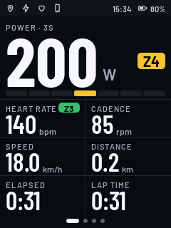
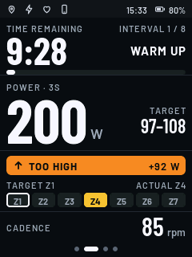
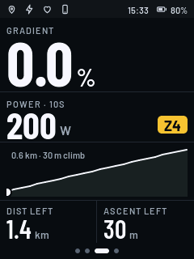
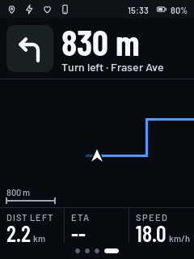
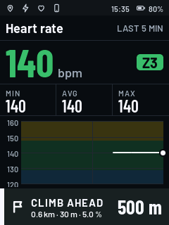
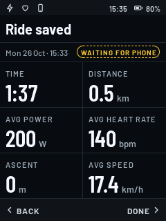
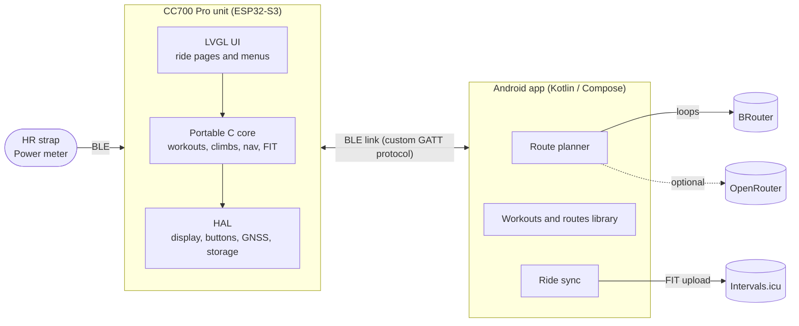

<div align="center">

# 🚴 Cycling 3000

**Ride software for the CC700 Pro bike computer, rebuilt from scratch.**<br>
Big, glanceable numbers, structured power workouts, routes and climbs on the unit, and an Android app that plans rides and uploads them.


</div>

<table>
  <tr>
    <td align="center"><br><sub><b>Main</b>: power, zones, HR, cadence</sub></td>
    <td align="center"><br><sub><b>Workout</b>: targets and live coaching</sub></td>
    <td align="center"><br><sub><b>Climb</b>: gradient and what's left</sub></td>
  </tr>
  <tr>
    <td align="center"><br><sub><b>Navigation</b>: route line and turn cues</sub></td>
    <td align="center"><br><sub><b>Heart rate</b>: last 5 minutes in zones</sub></td>
    <td align="center"><br><sub><b>Ride saved</b>: summary, then off to the phone</sub></td>
  </tr>
</table>

<sub>Screens rendered by the desktop simulator from the same UI code that runs on the unit (240 × 320).</sub>

---

## What it does

### On the bike
- **Four ride pages** (Main, Workout, Climb and Navigation) in a ring. A page with nothing to show (no workout loaded, no route) drops out.
- **Power-first display**: 3 s power with a seven-zone bar, heart rate with five zones, cadence, speed, distance, elapsed and lap time.
- **Structured workouts**: interval targets from your FTP, a time-remaining countdown, and *too high / too low* coaching against the target zone.
- **Routes and climbs**: GPX routes with turn cues and a route line. Climbs are detected ahead of time, with gradient, distance and ascent left.
- **Sensors**: Bluetooth heart-rate straps and power meters, both connected at once and reconnecting automatically.
- **Rides that survive**: FIT recording that recovers after a power cut, with laps, pause and a summary at the end.

### On the phone
- **Plan a ride**: say how long you want to ride and get three loops from where you are, favouring cycle paths, each with a map preview.
- **Ask AI** (optional): describe the ride ("mostly cycle paths, café stop halfway") and a language model picks and explains the loops. It only ever sees route stats, never your location.
- **Import** GPX routes and coach-format workouts, preview them (elevation profile, climbs), and send them to the unit over Bluetooth.
- **Sync rides** off the unit and upload them to **Intervals.icu**, with duplicate detection.
- **Set FTP** on the unit from the phone, and choose climb thresholds and the elevation source for imported routes.

---

## How it fits together



The same C core and UI run on the unit and in the desktop simulator (`simunit`). The Android app is tested against the simulator over TCP, so nearly everything is exercised without touching hardware.

---

## Repository layout

| Path | What's in it |
|---|---|
| `core/` | Portable C: workouts, zones, climbs, navigation, FIT encoding, link protocol |
| `ui/` | LVGL screens for every ride page and menu |
| `hal/` | Hardware abstraction interfaces (display, input, GNSS, storage, BLE), implemented by `simunit/` and `fw/` |
| `simunit/` | Desktop simulator of the whole unit, including the phone link over TCP |
| `fw/` | ESP-IDF firmware for the unit |
| `android/` | Companion app: `core` (pure Kotlin), `sync`, `testing` and `app` (Compose) |
| `tools/` | Reference implementation, test-vector generator and design-mockup tools |
| `docs/` | Progress log, open questions, bring-up log and screen renders |
| `claude/` | The design spec, engineering brief, BLE protocol and test vectors |

---

## Building and testing

```bash
make test       # host C tests (plain and ASan/UBSan) and Python tool tests
make vectors    # regenerate the golden test vectors; fails on any difference
make sim        # build the LVGL desktop simulator
make shots      # render every screen and the contact sheet
make android    # Android JVM tests (core, sync, testing)
make fw-build   # ESP-IDF firmware build (never flashes anything)
```

The Android app is in `android/`. Open it in Android Studio, or run `./gradlew :app:assembleDebug` with an Android SDK configured.

> [!WARNING]
> Nothing in this repository flashes the unit. Installing firmware on real hardware is a deliberate manual step, gated by the recovery procedure in `GEOID-CC700-Pro-complete-handover.md` (a verified full-flash backup comes first).

---

## Status

- ✅ Spec, protocol and golden test vectors
- ✅ Every screen in the simulator
- ✅ Android app: library, sync and upload, and the route planner
- ✅ Firmware skeleton
- ✅ On the unit: display, touch, buttons, the phone link over real Bluetooth, and HR and power sensors
- 🔜 Outdoor test ride: GNSS fix, a recorded ride and a route on the Nav screen

Day-to-day progress is in [`docs/PROGRESS.md`](docs/PROGRESS.md), and decisions waiting on an answer are in [`docs/QUESTIONS.md`](docs/QUESTIONS.md).

---

## Credits

Built on [LVGL](https://lvgl.io), [ESP-IDF](https://github.com/espressif/esp-idf) and NimBLE. Routing by [BRouter](https://brouter.de) and [OpenRouteService](https://openrouteservice.org). Map tiles © [OpenStreetMap](https://www.openstreetmap.org/copyright) contributors. Ride upload via [Intervals.icu](https://intervals.icu). The full list of dependencies and licences is in [`docs/THIRD_PARTY.md`](docs/THIRD_PARTY.md).

<sub>An independent personal project. Not affiliated with, endorsed by or supported by GEOID; "CC700 Pro" is used only to name the hardware this software runs on. Replacing a device's firmware may void its warranty and is done at your own risk.</sub>
